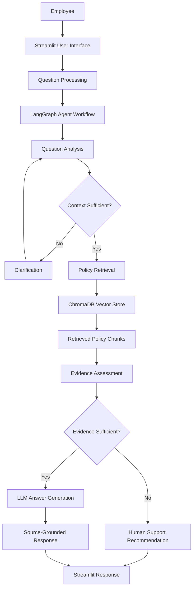
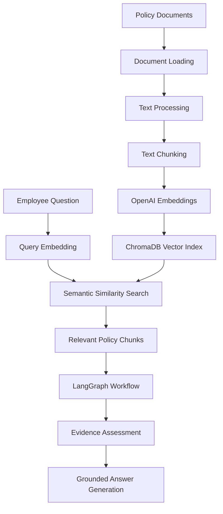

<div align="center">

# 🏢 PolicyPilot
### Agentic RAG Employee Policy & Onboarding Navigator

**An Intelligent AI-Powered Employee Assistant for Policy Discovery, Onboarding Guidance, and Evidence-Grounded Question Answering.**

<p>


</p>

<p>
<a href="https://github.com/devendrababu9666/Agentic-RAG-Capstone">

</a>
<a href="https://github.com/devendrababu9666/Agentic-RAG-Capstone/network/members">

</a>


</p>

</div>

---

## 📌 Overview

**PolicyPilot** is an Agentic Retrieval-Augmented Generation (RAG) application designed to simplify employee access to organizational policies, onboarding documentation, and workplace guidance.

In traditional organizations, employees frequently need to search through multiple policy documents or contact HR teams to find answers about onboarding, workplace procedures, finance, travel, equipment, and employee support.

PolicyPilot addresses this challenge through an intelligent AI assistant that retrieves relevant policy information, evaluates supporting evidence, and generates context-aware responses.

Unlike conventional single-pass RAG systems, PolicyPilot uses **LangGraph-based workflow orchestration** to coordinate multiple stages of question analysis, clarification, document retrieval, evidence assessment, and answer generation.

The application emphasizes evidence-grounded responses, source transparency, and responsible handling of questions when sufficient policy information is unavailable.

### 🎯 Project Objectives

- Automate employee policy information retrieval.
- Provide intelligent onboarding assistance.
- Implement Agentic RAG using LangGraph.
- Improve retrieval relevance through semantic search.
- Evaluate whether retrieved evidence adequately supports an answer.
- Handle ambiguous questions through clarification.
- Reduce unsupported AI-generated responses.
- Provide source-aware and transparent answers.

---

## ✨ Key Features

### 🧠 1. Agentic RAG Architecture

Implements a graph-based AI workflow using LangGraph instead of relying on a simple retrieve-and-generate pipeline.

- Structured workflow orchestration.
- Conditional routing between processing stages.
- Question analysis and context identification.
- Intelligent clarification handling.
- Evidence-aware answer generation.
- Controlled workflow execution.

### 📚 2. Intelligent Policy Retrieval

Uses ChromaDB as a persistent vector database to retrieve relevant information from employee policy documents.

Supported policy categories include:

- Employee Onboarding
- Equipment and Resources
- Finance and Expenses
- Employee Support
- Business Travel
- Workplace Policies

### 🔍 3. Semantic Search and Context Retrieval

Transforms policy documents into searchable vector representations.

- Document loading and processing.
- Text chunking.
- Embedding generation.
- Vector indexing.
- Semantic similarity search.
- Relevant context retrieval.

### 🔄 4. Dynamic Question Clarification

The workflow can identify when an employee's question lacks sufficient context.

Instead of immediately generating an answer, the assistant can request additional information to improve the relevance of subsequent retrieval and responses.

### 🛡️ 5. Evidence Assessment

An important component of PolicyPilot is its evidence assessment mechanism.

The application evaluates retrieved policy information before generating its final response.

It considers:

- Evidence sufficiency.
- Relevant policy passages.
- Potentially conflicting policy information.
- Missing supporting information.
- Whether human assistance is appropriate.

### 📖 6. Source-Grounded Responses

The assistant provides supporting policy information alongside generated answers.

This improves transparency and allows employees to review the underlying policy evidence.

### 💬 7. Conversational Context

Maintains recent conversation history to support contextual follow-up questions.

For example:

- What is the equipment policy?
- How do I request it?
- How long does the process take?

The assistant can use recent conversation context to interpret follow-up questions.

### 🧪 8. RAG Evaluation Framework

Includes a dedicated evaluation module to assess application behavior.

- Policy retrieval scenarios.
- Evidence assessment tests.
- Clarification handling.
- Multi-topic questions.
- Missing information scenarios.
- Conflicting evidence scenarios.
- Source relevance.
- Workflow validation.

---

## 🏗️ System Architecture

PolicyPilot follows a modular architecture separating the presentation layer, agentic workflow, retrieval pipeline, vector storage, and evaluation components.



### Architecture Components

| Component | Technology | Responsibility |
|---|---|---|
| Presentation Layer | Streamlit | Interactive employee assistant |
| Agent Orchestration | LangGraph | Workflow execution and conditional routing |
| AI Integration | LangChain | LLM and document-processing integration |
| Language Model | OpenAI | Reasoning and response generation |
| Embeddings | OpenAI Embeddings | Document and query vectorization |
| Vector Database | ChromaDB | Persistent semantic retrieval |
| Configuration | Python dotenv | Environment configuration |
| Validation | Pydantic | Configuration and data validation |
| Evaluation | Python unittest | Automated testing |

---

## 🔄 Agentic RAG Workflow

The main differentiator of PolicyPilot is its multi-stage, graph-based workflow.

Instead of executing a fixed RAG pipeline, the system coordinates different processing stages based on the employee's question and the available evidence.

### Workflow Stages

**Stage 1: Question Analysis**

The system analyzes the employee's question to identify:

- Main intent.
- Relevant policy topics.
- Required context.
- Whether clarification is necessary.

**Stage 2: Context Clarification**

If important information is missing, the workflow can request additional details before continuing.

**Stage 3: Policy Retrieval**

The system retrieves relevant policy passages from the ChromaDB vector store using semantic similarity search.

**Stage 4: Evidence Assessment**

The retrieved information is evaluated to determine whether it adequately supports the intended response.

The workflow also considers potentially conflicting information.

**Stage 5: Answer Generation**

The language model generates a response grounded in the retrieved policy information.

**Stage 6: Source Transparency**

Supporting policy sources and relevant excerpts are presented to the employee.

When evidence is insufficient or conflicting, the assistant can recommend contacting the appropriate support team.

---

## 🔌 RAG Pipeline

PolicyPilot implements a document ingestion and retrieval pipeline.



### Document Indexing Process

The `index_policies.py` module handles the policy indexing process.

1. Load policy documents.
2. Split documents into manageable chunks.
3. Generate embeddings.
4. Store vector representations in ChromaDB.
5. Make policy information available for semantic retrieval.

The vector index is persisted locally under:

```text
data/vector_store/
```

This avoids rebuilding the complete index for every employee question.

---

## 🧪 Evaluation and Testing

PolicyPilot includes a dedicated evaluation framework under the `evaluation/` directory.

The framework covers different aspects of Agentic RAG behavior.

| Evaluation Area | Objective |
|---|---|
| Policy Retrieval | Verify relevant policy information is retrieved |
| Clarification | Test handling of incomplete questions |
| Multi-topic Queries | Evaluate questions involving multiple policy categories |
| Conversational Context | Validate contextual follow-up questions |
| Missing Evidence | Check behavior when policy information is unavailable |
| Conflicting Evidence | Evaluate handling of potentially contradictory information |
| Source Relevance | Examine whether supporting sources are relevant |
| Workflow Validation | Test graph execution and conditional routing |

### Automated Testing

Run the unit tests:

```bash
python -m unittest discover -s evaluation -p "test_*.py" -v
```

### Evaluation Reports

The repository includes evaluation artifacts:

```text
reports/
├── evaluation_report.md
└── evaluation_run.json
```

These files provide documentation and recorded evaluation information.

**Development validation:** The existing project documentation records 11 passing unit tests, successful Python compilation, and successful development checks for retrieval and workflow execution. These are development results, not a guarantee that every evaluation scenario passes.

---

## 🛠️ Technology Stack

### Programming and Application Development

| Technology | Purpose |
|---|---|
| Python | Core application development |
| Streamlit | Interactive web interface |
| Pydantic | Configuration and data validation |
| python-dotenv | Environment variable management |

### Generative AI and Agentic AI

| Technology | Purpose |
|---|---|
| LangGraph | Stateful AI workflow orchestration |
| LangChain | LLM and document-processing integration |
| OpenAI API | Language model and embeddings |
| Prompt Engineering | Context-aware AI interactions |

### Retrieval-Augmented Generation

| Technology | Purpose |
|---|---|
| ChromaDB | Vector database |
| OpenAI Embeddings | Semantic document representation |
| LangChain Text Splitters | Document chunking |
| Semantic Search | Relevant policy retrieval |

### Testing and Evaluation

- Python unittest
- Automated workflow testing
- Evidence assessment testing
- Retrieval evaluation scenarios

---

## 📂 Project Structure

```text
Agentic-RAG-Capstone/
│
├── app.py
│
├── index_policies.py
│
├── show_graph.py
│
├── requirements.txt
│
├── .gitignore
│
├── README.md
│
├── employee_navigator/
│   ├── __init__.py
│   ├── config.py
│   ├── state.py
│   ├── rag.py
│   └── graph.py
│
├── data/
│   ├── policies/
│   │   ├── equipment/
│   │   ├── finance/
│   │   ├── onboarding/
│   │   ├── support/
│   │   ├── travel/
│   │   └── workplace/
│   │
│   └── vector_store/
│
├── evaluation/
│   ├── test_scenarios.json
│   ├── test_graph_unit.py
│   ├── test_evidence_assessment.py
│   └── run_evaluation.py
│
├── reports/
│   ├── evaluation_report.md
│   └── evaluation_run.json
│
└── Evidence_Screenshots/
```

---

## ⚙️ Installation and Setup

### Prerequisites

Make sure you have:

- Python 3.11
- pip
- Git
- OpenAI API key
- Internet connectivity

### 1. Clone the Repository

```bash
git clone https://github.com/devendrababu9666/Agentic-RAG-Capstone.git

cd Agentic-RAG-Capstone
```

### 2. Create a Virtual Environment

```bash
python -m venv .venv
```

### 3. Activate the Environment

**Windows PowerShell**

```powershell
.\.venv\Scripts\Activate.ps1
```

**Linux / macOS**

```bash
source .venv/bin/activate
```

### 4. Install Dependencies

```bash
python -m pip install -r requirements.txt
```

Verify dependencies:

```bash
python -m pip check
```

### 5. Configure Environment Variables

Create a `.env` file in the project root.

```env
OPENAI_API_KEY=your_openai_api_key

CHAT_MODEL=gpt-4.1

EMBEDDING_MODEL=text-embedding-3-large

CHUNK_SIZE=1000

CHUNK_OVERLAP=150

RETRIEVAL_K=8

MAX_HISTORY_MESSAGES=10
```

These are the project's documented default settings. Update them according to your configuration.

**Security:** Never upload your actual `.env` file or expose API keys in source code, screenshots, or logs.

### 6. Build the Policy Vector Index

Run:

```bash
python index_policies.py
```

This process:

- Loads policy documents.
- Splits documents into chunks.
- Generates embeddings.
- Creates or updates the ChromaDB vector index.

The indexing process can incur OpenAI API usage charges.

### 7. Run the Application

Start the Streamlit application:

```bash
python -m streamlit run app.py
```

Open the local application:

```text
http://localhost:8501
```

---

## 📊 Example Employee Questions

The following questions demonstrate the intended employee policy assistance use cases.

**Onboarding**

- What equipment should I prepare before joining remotely?
- What are the onboarding requirements?

**Equipment**

- How do I check the status of an equipment request?
- What is the process for requesting workplace equipment?

**Finance and Expenses**

- How should I report a missing expense receipt?
- What are the expense submission guidelines?

**Business Travel**

- What should I do if my business travel booking changes?

**Evidence Handling**

- How much will the company reimburse me for home internet?

The final question is particularly useful for evaluating whether the assistant acknowledges missing policy information rather than inventing an answer.

---

## 🛡️ Responsible AI and Limitations

PolicyPilot is designed around evidence-grounded AI responses and responsible information retrieval.

### Responsible AI Principles

- **Groundedness:** Generate responses using retrieved policy evidence.
- **Transparency:** Display supporting sources and excerpts.
- **Evidence Awareness:** Consider whether available information is sufficient.
- **Human Oversight:** Recommend human assistance for unresolved policy questions.
- **Context Awareness:** Request clarification when necessary.
- **Reliability:** Evaluate retrieval and workflow behavior through testing.

### Current Limitations

- The project uses fictional policy documents for demonstration.
- Evidence assessment depends partly on language-model judgments.
- Retrieval may not always identify every relevant policy passage.
- The assistant does not connect to live employee-management systems.
- It cannot approve expenses, equipment, or travel requests.
- It does not update employee records.
- Production deployment would require additional authentication, access controls, monitoring, and privacy safeguards.

---

## 🚀 Future Enhancements

Potential improvements for expanding PolicyPilot:

- [ ] Multi-agent collaboration for specialized HR domains.
- [ ] Advanced query decomposition.
- [ ] Hybrid search combining semantic and keyword retrieval.
- [ ] Cross-encoder reranking.
- [ ] Advanced RAG evaluation using RAGAS.
- [ ] Automated hallucination and faithfulness evaluation.
- [ ] Improved citation-level verification.
- [ ] Human-in-the-loop review interface.
- [ ] Enterprise document ingestion.
- [ ] Role-based access control.
- [ ] Conversation persistence across sessions.
- [ ] Deployment using Docker and cloud infrastructure.
- [ ] Advanced observability and performance monitoring.

---

## 👨‍💻 Author

<div align="center">

### Devendra Babu Pesarlanka

**AI/ML Engineer | Generative AI | Agentic AI | RAG Systems**

Interested in developing intelligent AI applications using Large Language Models, Retrieval-Augmented Generation, AI agents, workflow orchestration, and modern software engineering technologies.

<br/>

<a href="https://github.com/devendrababu9666">

</a>

<a href="https://www.linkedin.com/in/pesarlanka-devendrababu/">

</a>

</div>

---

<div align="center">

### PolicyPilot — Making Employee Knowledge Accessible Through AI.

**From Policy Documents to Intelligent, Evidence-Grounded Answers.**

⭐ If you find this project interesting, consider starring the repository!

</div>
